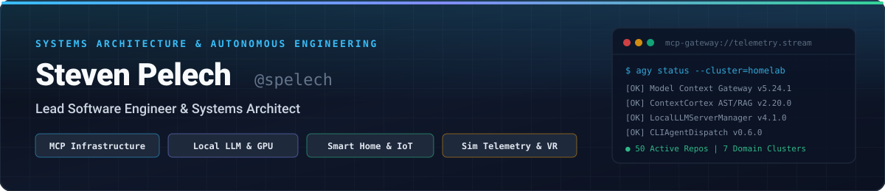
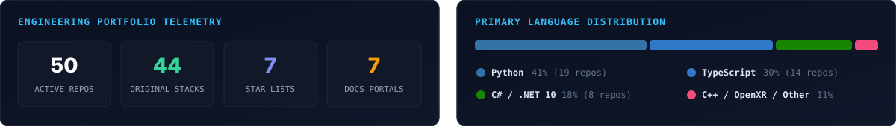
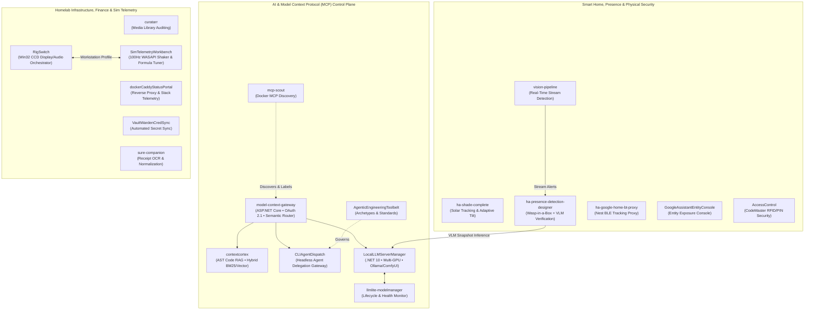

  

   

  <!-- Core Languages & Runtimes -->
  
  
  
  
  
  

   

  <!-- Infrastructure, AI & Automation -->
  
  
  
  
  
  

 

  

---

## Featured Flagship Systems

| System | Stack & Runtime | Live Docs | Architecture Highlights |
| :--- | :---: | :---: | :--- |
| **[contextcortex](https://github.com/spelech/contextcortex)** | `Python` `FastMCP` `pgvector` `SQLite-Vec` | **[Docs](https://spelech.github.io/contextcortex/)** | Multi-repo Model Context Protocol (MCP) server with syntax-aware **Tree-sitter AST chunking**, **Hybrid Retrieval (Dense + BM25)**, **OAuth 2.1 / 3-Tier RBAC**, and Web Admin Dashboard. |
| **[LocalLLMServerManager](https://github.com/spelech/LocalLLMServerManager)** | `C#` `.NET 10` `CUDA` `MCP` | **[Docs](https://spelech.github.io/LocalLLMServerManager/)** | Unified local AI orchestrator managing **Ollama**, **Stable Diffusion Forge**, **ComfyUI**, and **Kokoro TTS** with real-time GPU VRAM telemetry and MCP integration. |
| **[model-context-gateway](https://github.com/spelech/model-context-gateway)** | `C#` `ASP.NET Core` `React 19` `OAuth 2.0` | **[Docs](https://spelech.github.io/model-context-gateway/)** | Enterprise MCP Gateway Router, OAuth 2.0 Provider, and **Semantic Tool Catalog** connecting AI coding agents to distributed tool servers over a single authenticated connection. |
| **[CLIAgentDispatch](https://github.com/spelech/CLIAgentDispatch)** | `Python` `FastAPI` `FastMCP` | — | Universal headless and CLI AI agent delegation gateway bridging local execution engines (**Antigravity**, **OpenCode**, **T3 Code**) with FastMCP and LiteLLM. |
| **[curatarr](https://github.com/spelech/curatarr)** | `TypeScript` `Docker` | **[Docs](https://spelech.github.io/curatarr/)** | Intelligent media curation, duplicate auditing, and storage reclamation platform integrating **Plex**, **Tautulli**, **Sonarr**, **Radarr**, and **Overseerr**. |
| **[RigSwitch](https://github.com/spelech/RigSwitch)** | `C#` `.NET 10` `Win32 CCD` | **[Docs](https://spelech.github.io/RigSwitch/)** | Native Windows system tray control plane switching instantly between **Desk Setup** and **Sim-Rig Setup** at the Win32 CCD display driver and audio endpoint level. |

---

## System Architecture & Ecosystem Topology

---

## Recently Active Public Projects

<!-- RECENT_ACTIVITY:START -->
| Repository | Primary Stack | Docs | Last Push (UTC) | Description |
| :--- | :---: | :---: | :---: | :--- |
| **[LocalLLMServerManager](https://github.com/spelech/LocalLLMServerManager)** | `C#` | [Docs](https://spelech.github.io/LocalLLMServerManager/) | `2026-10-28` | C# / .NET management service and API for orchestrating local LLM backends, model routing, and GPU resource allocation. |
| **[contextcortex](https://github.com/spelech/contextcortex)** | `Python` | [Docs](https://spelech.github.io/contextcortex/) | `2026-10-28` | High-performance Model Context Protocol (MCP) server providing deep codebase indexing, AST analysis, and memory context. |
| **[RigSwitch](https://github.com/spelech/RigSwitch)** | `C#` | [Docs](https://spelech.github.io/RigSwitch/) | `2026-10-28` | Native Windows system tray control plane and workstation orchestrator for instant profile switching between desk and sim-rig. |
| **[CLIAgentDispatch](https://github.com/spelech/CLIAgentDispatch)** | `Python` | — | `2026-10-28` | Universal headless and CLI AI agent delegation gateway bridging local execution engines with FastMCP. |
| **[ha-shade-complete](https://github.com/spelech/ha-shade-complete)** | `Python` | — | `2026-10-27` | Comprehensive Home Assistant integration for motorized shades: sun tracking, virtual tilt entities, and adaptive battery calibration. |
| **[sure-companion](https://github.com/spelech/sure-companion)** | `TypeScript` | — | `2026-10-27` | Decoupled companion sidecar for Sure: vendor normalization, canonical categorization, and privacy-bounded receipt extraction |
| **[ha-presence-detection-designer](https://github.com/spelech/ha-presence-detection-designer)** | `Python` | — | `2026-10-27` | Home Assistant custom integration combining Wasp-in-a-Box presence, entity condition matrices, and VLM/LLM snapshot verification. |
| **[model-context-gateway](https://github.com/spelech/model-context-gateway)** | `C#` | [Docs](https://spelech.github.io/model-context-gateway/) | `2026-10-27` | C# ASP.NET Core Gateway Router, OAuth 2.0 Provider, and Semantic Tool Catalog for Model Context Protocol (MCP) servers. |
<!-- RECENT_ACTIVITY:END -->

---

## Browse by Category (Star Lists & Topic Filters)

| Category | Curated List (Folder View) | Topic Filter |
| :--- | :--- | :--- |
| **AI, LLM & MCP** | [stars/spelech/lists/ai-llm-mcp](https://github.com/stars/spelech/lists/ai-llm-mcp) | [`topic:cat-ai-mcp`](https://github.com/spelech?tab=repositories&q=topic%3Acat-ai-mcp) |
| **Smart Home & IoT** | [stars/spelech/lists/smart-home-iot](https://github.com/stars/spelech/lists/smart-home-iot) | [`topic:cat-smart-home`](https://github.com/spelech?tab=repositories&q=topic%3Acat-smart-home) |
| **Homelab & Infrastructure** | [stars/spelech/lists/homelab-infrastructure](https://github.com/stars/spelech/lists/homelab-infrastructure) | [`topic:cat-homelab`](https://github.com/spelech?tab=repositories&q=topic%3Acat-homelab) |
| **Sim Racing, VR & Hardware** | [stars/spelech/lists/sim-racing-hardware](https://github.com/stars/spelech/lists/sim-racing-hardware) | [`topic:cat-sim-rig`](https://github.com/spelech?tab=repositories&q=topic%3Acat-sim-rig) |
| **Personal Finance** | [stars/spelech/lists/personal-finance](https://github.com/stars/spelech/lists/personal-finance) | [`topic:cat-finance`](https://github.com/spelech?tab=repositories&q=topic%3Acat-finance) |
| **CAD, 3D & Thermal Printing** | [stars/spelech/lists/cad-3d-printing](https://github.com/stars/spelech/lists/cad-3d-printing) | [`topic:cat-cad-print`](https://github.com/spelech?tab=repositories&q=topic%3Acat-cad-print) |
| **UI/UX & Developer Tooling** | [stars/spelech/lists/ui-ux-devtools](https://github.com/stars/spelech/lists/ui-ux-devtools) | [`topic:cat-devtools`](https://github.com/spelech?tab=repositories&q=topic%3Acat-devtools) |

---

## Complete Public Repository Directory

### AI, LLM Orchestration & Model Context Protocol (MCP)
* **[contextcortex](https://github.com/spelech/contextcortex)** *(Python • [Docs](https://spelech.github.io/contextcortex/))* — Deep codebase indexing, AST analysis, and semantic memory MCP server.
* **[CLIAgentDispatch](https://github.com/spelech/CLIAgentDispatch)** *(Python)* — Headless and CLI AI agent delegation gateway bridging local execution engines with FastMCP.
* **[LocalLLMServerManager](https://github.com/spelech/LocalLLMServerManager)** *(C# • [Docs](https://spelech.github.io/LocalLLMServerManager/))* — .NET management service and API for orchestrating local LLM backends, model routing, and GPU allocation.
* **[model-context-gateway](https://github.com/spelech/model-context-gateway)** *(C# • [Docs](https://spelech.github.io/model-context-gateway/))* — ASP.NET Core Gateway Router, OAuth 2.0 Provider, and Semantic Tool Catalog for MCP servers.
* **[llmlite-modelmanager](https://github.com/spelech/llmlite-modelmanager)** *(Python)* — Lightweight orchestration layer for local LLM deployments, model lifecycle switching, and health monitoring.
* **[AgenticEngineeringToolbelt](https://github.com/spelech/AgenticEngineeringToolbelt)** *(Python • [Docs](https://spelech.github.io/AgenticEngineeringToolbelt/))* — Extensible engineering archetypes, architecture standards, and automation tools for autonomous AI pair programming.
* **[mcp-scout](https://github.com/spelech/mcp-scout)** *(Python)* — Active Docker container discovery, protocol handshake prober, and Compose label injector for MCP.

### Smart Home, Home Assistant & IoT Security
* **[ha-shade-complete](https://github.com/spelech/ha-shade-complete)** *(Python)* — Home Assistant integration for motorized shades: solar tracking, virtual tilt entities, and adaptive battery calibration.
* **[ha-presence-detection-designer](https://github.com/spelech/ha-presence-detection-designer)** *(Python)* — Home Assistant integration combining Wasp-in-a-Box presence, entity condition matrices, and VLM/LLM snapshot verification.
* **[GoogleAssistantEntityConsole](https://github.com/spelech/GoogleAssistantEntityConsole)** *(Python)* — Web interface and API console for inspecting, configuring, and testing Home Assistant Google Assistant exposures.
* **[ha-google-home-bt-proxy](https://github.com/spelech/ha-google-home-bt-proxy)** *(Python)* — Home Assistant integration turning Google Home and Nest smart speakers into active Bluetooth proxies.
* **[AccessControl](https://github.com/spelech/AccessControl)** *(C#)* — CodeMaster: Centralized access control, RFID/PIN/keypad management, and physical security authorization platform.
* **[vision-pipeline](https://github.com/spelech/vision-pipeline)** *(Python / HTML)* — Computer vision processing pipeline for real-time camera stream analysis, object detection, and alert routing.

### Homelab Infrastructure & Media Automation
* **[curatarr](https://github.com/spelech/curatarr)** *(TypeScript • [Docs](https://spelech.github.io/curatarr/))* — Intelligent media library auditing, duplicate detection, and decluttering platform for Plex, Tautulli, Sonarr, and Radarr.
* **[VaultWardenCredSync](https://github.com/spelech/VaultWardenCredSync)** *(Python)* — Automated credential synchronization service integrating Vaultwarden API with internal homelab scripts.
* **[dockerCaddyStatusPortal](https://github.com/spelech/dockerCaddyStatusPortal)** *(HTML / Python)* — Real-time web portal monitoring Docker Compose stacks, network ports, upstream endpoints, and Caddy reverse proxy routes.

### Sim Racing, Telemetry & Workstation Hardware
* **[RigSwitch](https://github.com/spelech/RigSwitch)** *(C# • [Docs](https://spelech.github.io/RigSwitch/))* — Native Windows system tray control plane and workstation orchestrator for instant profile switching between desk and sim-rig.
* **[SimTelemetryWorkbench](https://github.com/spelech/SimTelemetryWorkbench)** *(TypeScript • [Docs](https://spelech.github.io/SimTelemetryWorkbench/))* — Scientific telemetry visualization, 100 Hz 4-channel WASAPI shaker analyzer, UDP replay injector, and SimHub ShakeIt formula tuner.

### Personal Finance, CAD & Printing Pipelines
* **[sure-companion](https://github.com/spelech/sure-companion)** *(TypeScript)* — Decoupled companion sidecar for Sure: vendor normalization, canonical categorization, and privacy-bounded receipt extraction.
* **[NelkoP21WebPrint](https://github.com/spelech/NelkoP21WebPrint)** *(TypeScript)* — Interactive web canvas and thermal label design engine for Nelko P21 & ESC/POS Bluetooth printers.
* **[cadamContainer](https://github.com/spelech/cadamContainer)** *(TypeScript)* — Containerized service for CAD/AM model processing, mesh slicing, and additive manufacturing pipeline execution.
* **[StickerPipeline](https://github.com/spelech/StickerPipeline)** *(Python)* — Automated image processing engine for contour tracing, stroke generation, and die-cut sticker preparation.

### UI/UX & Developer Tooling
* **[Avalonia.LayoutInspector](https://github.com/spelech/Avalonia.LayoutInspector)** *(C#)* — Automated layout auditing, overflow detection, sibling collision checking, and responsive viewport inspection for Avalonia UI.
* **[playwright-layout-inspector](https://github.com/spelech/playwright-layout-inspector)** *(TypeScript)* — Playwright plugin for mobile and desktop UX auditing: overflow, touch targets, layout shifts, collisions, and WCAG reflow.
* **[vite-plugin-theme-editor](https://github.com/spelech/vite-plugin-theme-editor)** *(TypeScript)* — Live in-browser CSS variable theme editor for Vite with instant visual feedback and AST-preserving disk synchronization.
